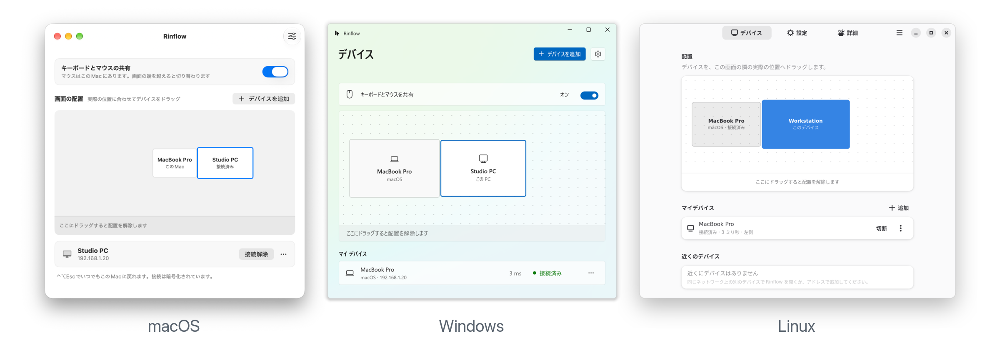

  <picture>
    <source media="(prefers-color-scheme: dark)" srcset="images/logo-dark.svg">
    
  </picture>

<h1 align="center">Rinflow</h1>

  1 組のキーボードとマウスで、Mac、Windows、Linux のコンピューターを操作できます。 
  ポインターを画面の端の先へ動かすと、次のコンピューターに移ります。

  <a href="README.md">English</a> · <a href="README.zh-CN.md">简体中文</a> · <b>日本語</b>

  <picture>
    <source media="(prefers-color-scheme: dark)" srcset="images/platforms-ja-JP-dark.png">
    
  </picture>

> [!NOTE]
> Rinflow は開発初期の段階です。すべてのデバイスで最新バージョンをお使いください。バージョンが異なると接続できない場合があります。

## Rinflow を選ぶ理由

- **速い。** 入力は、システムからネットワークまでコンパイル済みのネイティブ コードだけを通ります。ネットワークの処理は、どのプラットフォームでも同じ Rust ライブラリが担います。途中にブラウザー エンジンやインタープリターはありません。
- **ネイティブ。** 各アプリは、そのシステム標準の UI ツールキットで作られています。macOS は SwiftUI、Windows は WinUI 3、Linux は GTK 4 です。見た目も操作もシステムになじみ、英語、簡体字中国語、日本語に対応しています。
- **設定が簡単。** デバイスはローカル ネットワーク上で互いを自動的に見つけます。ペアリングでは、両方に同じ 6 桁のコードが表示されていることを確認するだけです。
- **サーバー不要。** どのコンピューターも対等です。どれからでもほかのコンピューターを操作でき、操作される側にもなれます。
- **クリップボードとファイル。** 1 台でコピーしたテキスト、画像、ファイルを、別のコンピューターで貼り付けられます。各コンピューターの設定でオン/オフを切り替えられます。
- **暗号化。** すべての接続に TLS 1.3 を使います。

## ダウンロード

| プラットフォーム | 動作環境 | サイズ | ダウンロード |
| --- | --- | --- | --- |
| macOS | macOS 14 以降、Apple シリコンまたは Intel | 6&nbsp;MB | [Releases](https://github.com/rinflow-dev/rinflow-macos/releases/latest) |
| Windows | Windows 10 バージョン 1809 以降、x64 または ARM64 | 18&nbsp;MB | [Releases](https://github.com/rinflow-dev/rinflow-windows/releases/latest) |
| Linux | Debian 13、Ubuntu 24.04 以降、GNOME 45 または KDE Plasma 6.1 以降の Wayland セッション、x86_64 または arm64 | 3&nbsp;MB | [Releases](https://github.com/rinflow-dev/rinflow-linux/releases/latest) |

[rinflow.com](https://rinflow.com/ja/#download) では、お使いのコンピューターに合ったファイルが自動で選ばれます。

## はじめに

1. 同じローカル ネットワーク上の各コンピューターに Rinflow をインストールして起動します。Mac では「アクセシビリティ」の許可が必要です。Linux では、デスクトップが Rinflow によるポインターとキーボードの操作を許可するか尋ねるので、許可します。
2. もう一方のコンピューターを追加し、両方に同じ 6 桁のコードが表示されていることを確認します。
3. そのコンピューターを、実際に置いてある側の画面の端へドラッグします。
4. ポインターをその端の先へ動かします。**Ctrl+Alt+Esc**（Mac では **⌃⌥Esc**）で操作を戻せます。

## フィードバック

プラットフォームを問わず、不具合の報告や機能のリクエストは [Issues](https://github.com/rinflow-dev/rinflow/issues) へお寄せください。セキュリティの問題については [SECURITY.md](SECURITY.md) をご覧ください。

## リポジトリ

| リポジトリ | 内容 |
| --- | --- |
| [rinflow-macos](https://github.com/rinflow-dev/rinflow-macos) | macOS アプリ（Swift） |
| [rinflow-windows](https://github.com/rinflow-dev/rinflow-windows) | Windows アプリ（Rust、WinUI 3） |
| [rinflow-linux](https://github.com/rinflow-dev/rinflow-linux) | Linux アプリ（Rust、GTK 4） |
| [rinflow-core](https://github.com/rinflow-dev/rinflow-core) | 共通の Rust ライブラリ：デバイスの検出、暗号化接続、入力プロトコル |

ビルド方法は各リポジトリをご覧ください。いずれも [Mozilla Public License 2.0](https://www.mozilla.org/MPL/2.0/) で公開しています。
