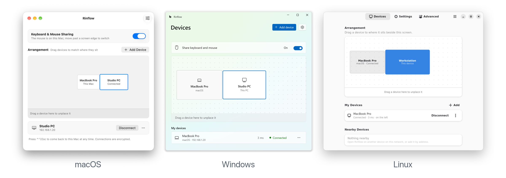

  <picture>
    <source media="(prefers-color-scheme: dark)" srcset="images/logo-dark.svg">
    
  </picture>

<h1 align="center">Rinflow</h1>

  One keyboard and mouse for your Mac, Windows and Linux computers. 
  Push the pointer past a screen edge, and it continues on the next one.

  <b>English</b> · <a href="README.zh-CN.md">简体中文</a> · <a href="README.ja.md">日本語</a>

  <picture>
    <source media="(prefers-color-scheme: dark)" srcset="images/platforms-en-US-dark.png">
    
  </picture>

> [!NOTE]
> Rinflow is in early development. Keep every device on the latest version: different versions may not connect.

## Why Rinflow

- **Fast.** Your input goes from the system to the network in compiled native code, and one Rust library does the networking on every platform. There is no browser engine or interpreter on the way.
- **Native.** Each app is written with its system's own toolkit: SwiftUI on macOS, WinUI 3 on Windows, GTK 4 on Linux. It looks and behaves like the system around it, in English, Simplified Chinese or Japanese.
- **Easy to set up.** Devices find each other on your local network. To pair two of them, check that both show the same six-digit code.
- **No server.** Every computer is equal: any of them can control the others, and be controlled.
- **Clipboard and files.** Copy text, images or files on one computer and paste them on another. A setting on each computer turns this on or off.
- **Encrypted.** Every connection uses TLS 1.3.

## Download

| Platform | Requirements | Size | Download |
| --- | --- | --- | --- |
| macOS | macOS 14 or later, Apple silicon or Intel | 6&nbsp;MB | [Releases](https://github.com/rinflow-dev/rinflow-macos/releases/latest) |
| Windows | Windows 10 version 1809 or later, x64 or ARM64 | 18&nbsp;MB | [Releases](https://github.com/rinflow-dev/rinflow-windows/releases/latest) |
| Linux | Debian 13, Ubuntu 24.04 or later, with GNOME 45 or KDE Plasma 6.1 or later on Wayland; x86_64 or arm64 | 3&nbsp;MB | [Releases](https://github.com/rinflow-dev/rinflow-linux/releases/latest) |

[rinflow.com](https://rinflow.com/#download) picks the right file for your computer.

## Getting started

1. Install and start Rinflow on each computer, on the same local network. On a Mac, grant it the Accessibility permission. On Linux, allow it when the desktop asks whether Rinflow may control the pointer and keyboard.
2. Add the other computer, and check that both show the same six-digit code.
3. Drag it to the side of your screen where it sits.
4. Push the pointer past that edge. **Ctrl+Alt+Esc** (**⌃⌥Esc** on a Mac) brings it back.

## Feedback

Report bugs and request features in [Issues](https://github.com/rinflow-dev/rinflow/issues), whatever the platform. For security problems, see [SECURITY.md](SECURITY.md).

## Repositories

| Repository | Contents |
| --- | --- |
| [rinflow-macos](https://github.com/rinflow-dev/rinflow-macos) | macOS app (Swift) |
| [rinflow-windows](https://github.com/rinflow-dev/rinflow-windows) | Windows app (Rust, WinUI 3) |
| [rinflow-linux](https://github.com/rinflow-dev/rinflow-linux) | Linux app (Rust, GTK 4) |
| [rinflow-core](https://github.com/rinflow-dev/rinflow-core) | Shared Rust library: discovery, encrypted connections, input protocol |

Build instructions are in each repository. All are licensed under the [Mozilla Public License 2.0](https://www.mozilla.org/MPL/2.0/).
