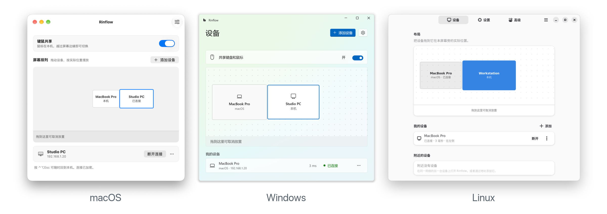

  <picture>
    <source media="(prefers-color-scheme: dark)" srcset="images/logo-dark.svg">
    
  </picture>

<h1 align="center">Rinflow</h1>

  一套键盘鼠标，控制你的 Mac、Windows 和 Linux 电脑。 
  指针移过屏幕边缘，就到了下一台电脑上。

  <a href="README.md">English</a> · <b>简体中文</b> · <a href="README.ja.md">日本語</a>

  <picture>
    <source media="(prefers-color-scheme: dark)" srcset="images/platforms-zh-CN-dark.png">
    
  </picture>

> [!NOTE]
> Rinflow 处于早期开发阶段。请让所有设备都使用最新版本，不同版本之间可能无法连接。

## 为什么用 Rinflow

- **快。** 输入从系统到网络，全程是编译好的原生代码，各平台的网络部分都由同一个 Rust 库完成。中间没有浏览器引擎，也没有解释器。
- **原生。** 每个应用都用所在系统自己的界面框架编写：macOS 用 SwiftUI，Windows 用 WinUI 3，Linux 用 GTK 4。外观和操作都与系统一致，支持英文、简体中文和日文界面。
- **设置简单。** 设备在局域网内自动互相发现。配对时，确认两边显示的六位数字相同即可。
- **不分主从。** 每台电脑都平等：任意一台都能控制其他电脑，也能被控制。
- **剪贴板和文件。** 在一台电脑上复制文字、图片或文件，到另一台上粘贴。每台电脑的设置里都可以开关。
- **加密。** 所有连接都使用 TLS 1.3。

## 下载

| 平台 | 系统要求 | 大小 | 下载 |
| --- | --- | --- | --- |
| macOS | macOS 14 或更高版本，Apple 芯片或 Intel | 6&nbsp;MB | [Releases](https://github.com/rinflow-dev/rinflow-macos/releases/latest) |
| Windows | Windows 10 1809 或更高版本，x64 或 ARM64 | 18&nbsp;MB | [Releases](https://github.com/rinflow-dev/rinflow-windows/releases/latest) |
| Linux | Debian 13、Ubuntu 24.04 或更高版本，GNOME 45 或 KDE Plasma 6.1 及以上的 Wayland 会话；x86_64 或 arm64 | 3&nbsp;MB | [Releases](https://github.com/rinflow-dev/rinflow-linux/releases/latest) |

也可以在 [rinflow.com](https://rinflow.com/zh/#download) 下载，网站会自动选择适合你电脑的文件。

## 开始使用

1. 在每台电脑上安装并打开 Rinflow，并连接到同一个局域网。Mac 上需要授予“辅助功能”权限。Linux 上，桌面会询问是否允许 Rinflow 控制指针和键盘，选择允许。
2. 添加另一台电脑，确认两边显示的六位数字相同。
3. 把它拖到屏幕上对应的那一侧。
4. 把指针推过那条边。按 **Ctrl+Alt+Esc**（Mac 上是 **⌃⌥Esc**）可以收回控制。

## 反馈

无论哪个平台，问题和建议都请提交到 [Issues](https://github.com/rinflow-dev/rinflow/issues)。安全问题请参阅 [SECURITY.md](SECURITY.md)。

## 仓库

| 仓库 | 内容 |
| --- | --- |
| [rinflow-macos](https://github.com/rinflow-dev/rinflow-macos) | macOS 应用（Swift） |
| [rinflow-windows](https://github.com/rinflow-dev/rinflow-windows) | Windows 应用（Rust、WinUI 3） |
| [rinflow-linux](https://github.com/rinflow-dev/rinflow-linux) | Linux 应用（Rust、GTK 4） |
| [rinflow-core](https://github.com/rinflow-dev/rinflow-core) | 共用的 Rust 库：设备发现、加密连接、输入协议 |

构建方法见各仓库。所有仓库均采用 [Mozilla Public License 2.0](https://www.mozilla.org/MPL/2.0/) 许可。
